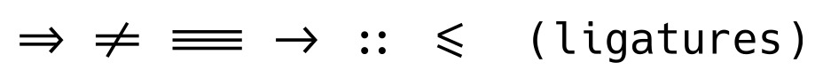
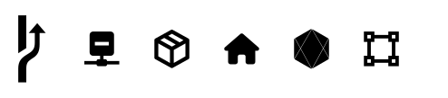

# Hack Nerd Font Ligatured (Nerd Fonts 3.5.1)

**Hack 3.003** + programming ligatures (**Fira Code 3.1** / **JetBrains Mono 2.242**) + **Nerd Fonts 3.5.1** icons, built with [Ligaturizer](https://github.com/ToxicFrog/Ligaturizer).



## Why this exists

The last release of [gaplo917/Ligatured-Hack](https://github.com/gaplo917/Ligatured-Hack) (2022) is based on Nerd Fonts 2.1.0, and its `=` ligature chains are broken under current HarfBuzz: `=` is globally substituted with an intermediate glyph, so `=>`, `==`, `!=`, `<=` and `===` never reach the ligature (verified with `hb-shape`; `->`, `<-`, `::` still work). This repo rebuilds the same idea against Nerd Fonts 3.5.1 with a current FontForge and fixes the build for modern toolchains.

## Fonts

Every family ships **Regular / Bold / Italic / Bold Italic**:

| Family | Icons |
|---|---|
| `Hack Nerd Font FC Ligatured NF3` | double-width, Fira Code ligatures |
| `Hack Nerd Font JBM Ligatured NF3` | double-width, JetBrains Mono ligatures |
| `Hack Nerd Font Mono FC Ligatured NF3` | single-width (terminals), Fira Code ligatures |
| `Hack Nerd Font Mono JBM Ligatured NF3` | single-width (terminals), JetBrains Mono ligatures |

16 TTFs in total, no "copy character glyphs" (CCG) variants, so the letterforms stay 100% Hack.

## Build

Requirements: `fontforge` CLI with Python support (tested with 20251009), `make`, `curl`, `unzip`.

```sh
brew install fontforge          # macOS
./scripts/fetch-deps.sh         # pinned + SHA-256 verified sources
make
```

Outputs land in `fonts/output/`.

Pinned inputs:

- Nerd Fonts 3.5.1 `Hack.zip` — `fa24da7de7cefe7766614d27762570b20453c852fc1d5b657111666df9a5e449`
- Fira Code 3.1 — `cbcabd2c412ee4c3fec4688be8387de18a33bb77bc5c5988e9fd9293a0b9dbb7`
- JetBrains Mono 2.242 — `4e315b4ef176ce7ffc971b14997bdc8f646e3d1e5b913d1ecba3a3b10b4a1a9f`

## Changes vs. upstream

- `build.py`: Nerd Fonts 3.x file names (`HackNerdFont-*.ttf`, `HackNerdFontMono-*.ttf`), 8 inputs, only non-CCG outputs, family suffix `NF3` to coexist with the old build.
- `ligaturize.py`: side-bearing assignments coerced to `int` (FontForge ≥ 2023 rejects float assignment).
- `scripts/fetch-deps.sh`: reproducible, checksum-verified dependency fetch.
- No Docker / Travis CI.

## Verification

- 12,784–12,866 glyphs per font (the NF 2.1.0 build has 5,613).
- GSUB lookups: 498 (Fira Code) / 469 (JetBrains Mono).
- `hb-shape`: `=>` `!=` `===` `->` `::` `<=` shape into ligature glyphs; a plain `=` still shapes to `equal`.
- Icons render: U+E0A0 (branch), U+F0378 (`nf-md-minus_network`), U+F03D7 (`nf-md-package_variant_closed`), U+F015 (home), U+F0001 (new MDI range).
- Italic angle preserved (−11°).



## Install

macOS: copy the TTFs to `~/Library/Fonts` (or double-click and install with Font Book), then restart the terminal/editor.

VS Code:

```jsonc
"editor.fontFamily": "Hack Nerd Font Mono FC Ligatured NF3",
"editor.fontLigatures": true,
"terminal.integrated.fontFamily": "Hack Nerd Font Mono FC Ligatured NF3",
"terminal.integrated.fontLigatures.enabled": true
```

iTerm2: **Profiles → Text → Font**, choose `Hack Nerd Font Mono FC Ligatured NF3`, enable *Use ligatures*.

### Powerlevel10k

If you enable icon segments (`network`, `package`, cloud providers, distro icons), set:

```zsh
POWERLEVEL9K_MODE=nerdfont-v3
```

The old `nerdfont-complete` mode still uses Material Design Icons codepoints removed in Nerd Fonts 3.0 (e.g. `U+F50D`, `U+F8D6`), which now belong to other icon sets.

## Releases

Prebuilt fonts: see the [Releases](../../releases) page. Each archive contains the 16 TTFs, a short README and the license texts.

## License

Build scripts: **GPL-3.0**, inherited from [gaplo917/Ligatured-Hack](https://github.com/gaplo917/Ligatured-Hack) which is based on [ToxicFrog/Ligaturizer](https://github.com/ToxicFrog/Ligaturizer).

Font components:

- Hack — MIT, Copyright 2018 Source Foundry Authors (`LICENSES/Hack-LICENSE.md`)
- Fira Code — SIL OFL 1.1 (`LICENSES/FiraCode-LICENSE.txt`)
- JetBrains Mono — SIL OFL 1.1 (`LICENSES/JetBrainsMono-OFL.txt`)
- Nerd Fonts icon sets — see `LICENSES/NerdFonts-LICENSE.md`

Keep these notices when redistributing the generated fonts.

## Credits

- [Source Foundry Hack](https://github.com/source-foundry/Hack)
- [Nerd Fonts](https://github.com/ryanoasis/nerd-fonts)
- [Fira Code](https://github.com/tonsky/FiraCode), [JetBrains Mono](https://github.com/JetBrains/JetBrainsMono)
- [Ligaturizer](https://github.com/ToxicFrog/Ligaturizer) and [gaplo917/Ligatured-Hack](https://github.com/gaplo917/Ligatured-Hack)
